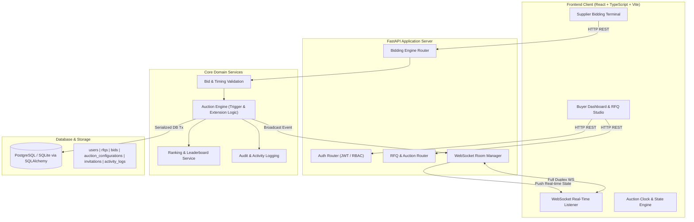
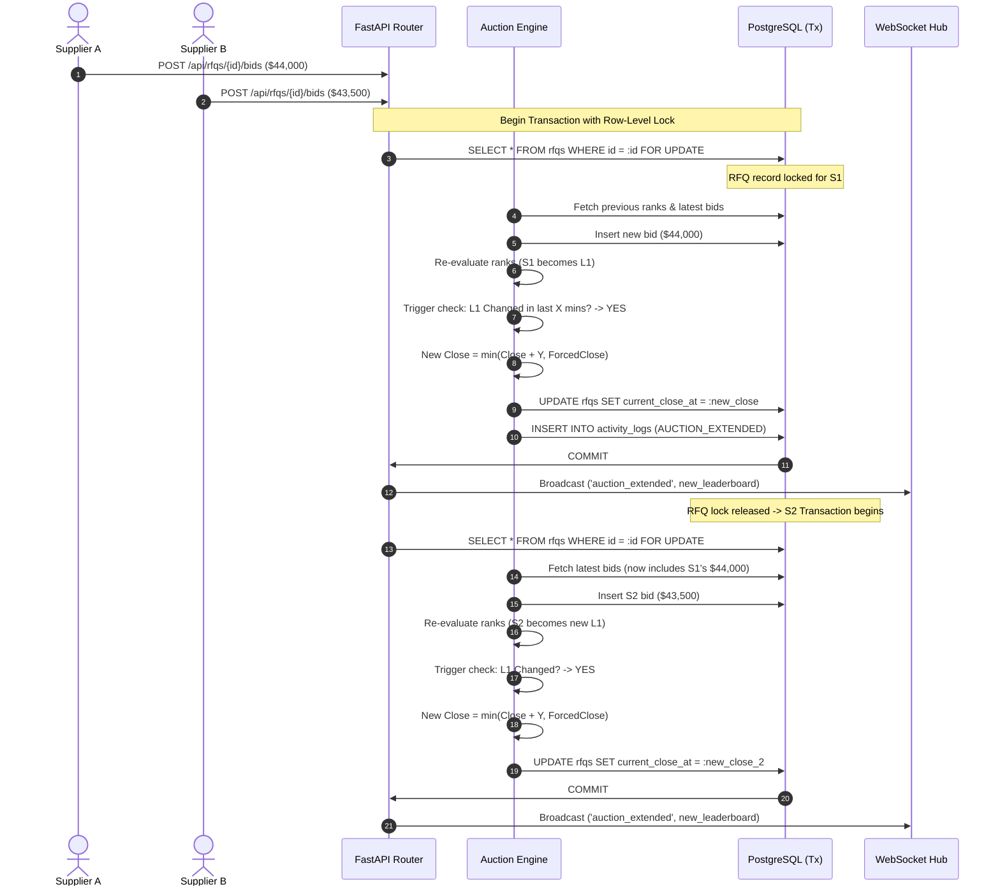
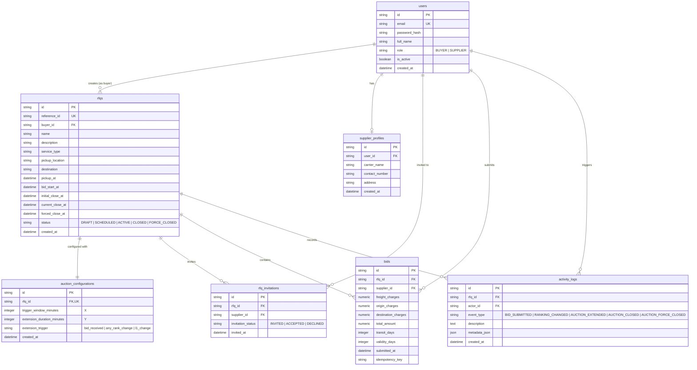

# High-Level Architecture & Technical Specification

---

## 1. System Overview & Technology Stack

The British Auction RFQ platform is built on an enterprise multi-tier architecture designed for low-latency state synchronization, strict data consistency, and seamless user experiences.

### Component Stack
| Tier | Technology | Purpose |
|---|---|---|
| **Frontend** | React 18, TypeScript, Vite | Fast Single Page Application (SPA) |
| **Styling & UI** | Tailwind CSS, Lucide Icons | Responsive modern procurement interface |
| **Backend API** | Python 3.9+, FastAPI, Pydantic v2 | High-throughput async REST endpoints |
| **ORM / Storage** | SQLAlchemy 2.0 (PostgreSQL / SQLite) | ACID transactions, explicit relation models |
| **Real-Time** | FastAPI Native WebSockets (`WebSocketEndpoint`) | Bi-directional auction events & countdown sync |
| **Security** | Python-jose, Passlib (bcrypt), OAuth2 Bearer | JWT authentication, role guards |

---

## 2. Concurrency & Extension Atomicity

In live reverse auctions, two suppliers may submit bids within milliseconds of each other. A race condition could result in:
1. Double-calculating extensions (e.g. extending by $2Y$ instead of $Y$).
2. Stale rank evaluations (wrong supplier declared $L1$).

### Locking & Serialization Strategy

---

## 3. Database Schema Design (7 Tables)

---

## 4. API Endpoints Specification

### 4.1 Authentication (`/api/auth`)
- `POST /api/auth/register`: Create user (`BUYER` or `SUPPLIER` + carrier profile).
- `POST /api/auth/login`: Form-encoded login returning JWT `access_token` and user profile.
- `GET /api/auth/me`: Current user session and claims.

### 4.2 RFQ Management (`/api/rfqs`)
- `POST /api/rfqs`: Create new RFQ with British Auction configuration.
- `GET /api/rfqs`: List RFQs (filtered by status or buyer ownership).
- `GET /api/rfqs/{id}`: Detailed RFQ view with configuration and current status.
- `POST /api/rfqs/{id}/publish`: Transition from `DRAFT` to `SCHEDULED` or `ACTIVE`.
- `POST /api/rfqs/{id}/invite`: Invite supplier(s) by ID or email.

### 4.3 Bidding & Auctions (`/api/rfqs/{id}/bids` & `/api/auctions`)
- `POST /api/rfqs/{id}/bids`: Submit initial quote or counter-bid.
- `GET /api/rfqs/{id}/leaderboard`: Return sorted list of participants ($L1, L2, \dots$) with current prices.
- `GET /api/rfqs/{id}/my-bids`: Retrieve historical bids submitted by the authenticated supplier.
- `GET /api/rfqs/{id}/bids`: Complete audit trail of bids for Buyer.
- `GET /api/rfqs/{id}/activity`: Complete activity log including extension reasons.

### 4.4 WebSocket Real-Time Channel (`/ws/auctions/{rfq_id}`)
- **Client Handshake:** `ws://localhost:8000/ws/auctions/{rfq_id}?token={jwt}`
- **Server Events:**
  - `CONNECTED`: Initial sync of clock time, current close time, forced close time, and status.
  - `BID_PLACED`: Inform subscribers of new quote event.
  - `LEADERBOARD_UPDATED`: Full updated rankings.
  - `AUCTION_EXTENDED`: `{ new_close_at, extension_minutes, reason, forced_close_at }`
  - `AUCTION_CLOSED`: `{ status: "CLOSED" | "FORCE_CLOSED" }`
