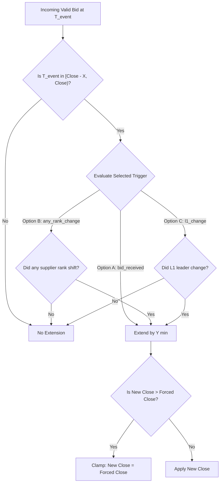

# Assignment Submission: British Auction in RFQ System
## Enterprise Reverse Procurement Platform with Dynamic Time Extensions & Forced Close Rules

---

### Executive Summary

This document represents the formal submission for the **British Auction in RFQ System** assignment. It encompasses product discovery, user experience architecture, systems design, and full technical implementation using **FastAPI (Python)**, **React (TypeScript + Vite)**, **Tailwind CSS**, and **Native WebSockets**.

The system addresses the core failure mode of fixed-deadline procurement (bid sniping and supplier margin hoarding) by introducing an automated, multi-tiered dynamic extension engine that guarantees fair price discovery while strictly enforcing operational logistics deadlines through an immutable forced-close ceiling.

---

## 1. Background

### 1.1 What is an RFQ (Request for Quotation)?
An **RFQ (Request for Quotation)** is an enterprise procurement workflow where a buyer (such as a freight forwarder, manufacturer, or 3PL logistics provider) invites multiple qualified carriers/suppliers to submit binding bids for transport or commercial services over specified routes (e.g., *Delhi to Mumbai, 50 MT Temperature-Controlled Freight*).

In conventional static RFQs:
- Bidding deadlines are fixed (e.g. 6:00 PM).
- Suppliers often submit quotes once or hold their best prices until the final moments.
- Buyers lack competitive visibility, often paying inflated margins due to insufficient real-time price pressure.

### 1.2 What is a British Auction in Reverse Procurement?
A **British Auction** (applied to reverse procurement) transforms static quotation collection into an open, iterative downward auction:
- **Downside Bidding:** Carriers submit bids openly and can continuously lower prices to improve rank ($L1, L2, L3\dots$).
- **Dynamic Time Extensions:** If bidding activity occurs within a configurable **Trigger Window ($X$ minutes)** near the scheduled deadline, the auction automatically extends by **$Y$ minutes**, preventing last-second bid sniping.
- **Forced Close Hard Ceiling:** An immutable **Forced Bid Close Time** ensures the auction terminates definitively, safeguarding logistics dispatch schedules.

---

## 2. Problem Statement

In standard freight procurement, suppliers exploit fixed closing times through **bid sniping**—submitting undercut bids seconds before closure (e.g. 5:59:59 PM). Competitors are unable to react, leading to:
1. **Suppressed Competition:** High-quality carriers lose contracts simply due to network latency or lack of opportunity to counter.
2. **Sub-optimal Pricing for Buyers:** The buyer fails to achieve true marginal-cost pricing.
3. **Disengagement:** Unsuccessful carriers distrust the procurement platform.

**Goal:** Design and build an authoritative reverse auction engine supporting configurable extension triggers, forced close rules, and real-time bidder synchronization.

---

## 3. Product Goals & Business Objectives

| Goal | Description | Target Business Impact |
|---|---|---|
| **Eliminate Last-Second Sniping** | Automatic extensions give all suppliers a fair reaction window when prices drop near the deadline. | 100% elimination of un-countered last-minute snipes |
| **Maximize Fair Price Discovery** | Real-time leaderboards ($L1, L2\dots$) incentivize incremental price cuts toward market clearing rates. | 8% – 15% reduction in freight procurement spend |
| **Guaranteed Operational SLAs** | The forced close deadline prevents procurement processes from spilling over into dispatch windows. | Zero auction overruns beyond operational ceilings |
| **Audit Compliance & Transparency** | Every bid, rank movement, and time extension is recorded with a machine-verifiable explanation. | 100% audit compliance for corporate procurement |

---

## 4. Success Metrics

1. **Bids per RFQ:** Average number of competitive bids submitted per RFQ (Target: $\ge 4.5$ counter-bids per participating carrier).
2. **Procurement Cost Reduction:** Percentage delta between the initial baseline quote and the final winning $L1$ price.
3. **Carrier Engagement Rate:** Percentage of invited carriers who submit at least one counter-bid when overtaken.
4. **On-Time Auction Termination:** 100% of auctions closed on or before $T_{forced}$.

---

## 5. Core Functional Requirements

### 5.1 RFQ Creation & Management (Buyer)
- **Shipment Specification:** Name, unique reference ID (`RFQ-YYYYMMDD-XXXX`), service type, origin, destination, and pickup date.
- **Timing Parameters:**
  - $T_{start}$: Bidding start datetime.
  - $T_{close}$: Scheduled bid close datetime.
  - $T_{forced}$: Non-negotiable forced close datetime.
- **British Auction Configuration:** Enable/disable toggle, Trigger Window ($X$), Extension Duration ($Y$), and Extension Trigger condition.
- **Supplier Invitations:** Multi-select from verified carrier registry.

### 5.2 Quote Submission & Re-bidding (Carrier)
- **Cost Breakdown:** Freight charges, Origin handling charges, Destination handling charges.
- **Calculated Total:** Server-calculated:
  $$\text{Total} = \text{Freight} + \text{Origin} + \text{Destination}$$
- **Commercial Terms:** Committed transit days and quotation validity days.
- **Downside Bidding Rule:** Any counter-bid must be strictly lower than the carrier's previous lowest valid bid ($\text{Bid}_{new} < \text{Bid}_{prev}$).

---

## 6. British Auction Configuration Options

The platform gives buyers control over how auction extensions behave:

### 6.1 Trigger Window ($X$ Minutes)
Defines how close to the scheduled close time the system monitors bidding activity.
- *Example:* Scheduled close at 6:00 PM, $X = 10\text{ min}$. System monitors activity during $[5:50\text{ PM}, 6:00\text{ PM})$.

### 6.2 Extension Duration ($Y$ Minutes)
Defines the additional time added to the current close time upon a qualifying event.
- *Example:* Close at 6:00 PM, $Y = 5\text{ min} \implies \text{New Close} = 6:05\text{ PM}$.

### 6.3 Three Configurable Extension Triggers



- **Option A (`bid_received`):** Any valid bid received during the trigger window triggers an extension.
- **Option B (`any_rank_change`):** The auction extends only if the bid alters the relative order of any two suppliers (e.g. $L3 \to L2$).
- **Option C (`l1_change`):** The auction extends **only** when a new carrier captures the lowest price position ($L1$).

---

## 7. Validation Rules & Mathematical Invariants

1. **Temporal Ordering:**
   $$T_{start} < T_{close} < T_{forced}$$
2. **Forced Close Invariant (Ceiling Rule):**
   $$T_{close}^{new} = \min(T_{close} + Y, T_{forced})$$
   Under no condition shall an extension push $T_{close} > T_{forced}$.
3. **Downside Bidding Invariant:**
   $$\forall k, \quad \text{Total}_{new}^{(k)} < \min_{i < new} \left(\text{Total}_{i}^{(k)}\right)$$
4. **Server Clock Sovereignty:**
   All timestamp validations are evaluated against the backend UTC clock (`datetime.utcnow()`). Client countdowns are presentation-only.

---

## 8. Screen Architecture & Live Implementation

### 8.1 Buyer Dashboard & RFQ Listing
- Displays summary KPI cards: Total RFQs, Active Auctions, Closed Auctions, Total Bids.
- Status filters: `ALL`, `ACTIVE`, `SCHEDULED`, `CLOSED`.
- Data table: RFQ Name, Reference ID, Route, Current Lowest Bid ($L1$), Scheduled Close Time, Forced Close Time, and Status Badge.

### 8.2 RFQ Creation Studio
- 4-step guided builder with dynamic validation.
- Smart auto-bump: If scheduled close time is adjusted past forced close time, forced close automatically bumps forward by 30 minutes.
- 1-click presets: `+15m`, `+30m`, `+1h`.

### 8.3 Live Auction Details & Monitoring Cockpit
- Real-time countdown clock displaying scheduled close and forced close ceiling.
- Live Leaderboard with charges breakdown, transit days, validity, and $L1/L2/L3$ rank badges.
- Live Audit Log recording every bid, rank shift, and extension with exact reasons (e.g. *"New L1 lowest bidder (DHL Express India) emerged in the last 10 minutes"*).
- Evaluator Simulation Cockpit: 1-click test triggers to evaluate all 3 British Auction rules instantly.

### 8.4 Carrier Bidding Terminal
- Prominent Rank Badge: Green $L1$ badge if winning, Amber $L2+$ badge with distance to leader.
- Real-time counter-bid submission with automatic total calculation and client-side downside warning.
- Animated extension banner: displays time added and trigger explanation.

---

## 9. Deliverables & Technical Verification

### 9.1 Technology Stack
- **Frontend:** React 18, TypeScript, Vite, Tailwind CSS, Lucide Icons.
- **Backend:** Python 3.9+, FastAPI, Pydantic v2, SQLAlchemy 2.0.
- **Real-Time:** Native WebSockets with in-memory connection room manager.
- **Database:** Dual support: SQLite (local zero-dependency dev) & PostgreSQL (production).

### 9.2 Automated Test Proof (10/10 Passing)
```bash
source backend/venv/bin/activate
PYTHONPATH=backend pytest backend/tests/ -v
```
- ✅ `test_trigger_a_bid_received_inside_window`
- ✅ `test_trigger_a_bid_received_outside_window`
- ✅ `test_trigger_b_any_rank_change`
- ✅ `test_trigger_c_l1_rank_change`
- ✅ `test_forced_close_ceiling_clamping`
- ✅ `test_downside_bidding_rule_rejection`
- ✅ `test_health`, `test_login_buyer`, `test_login_supplier`, `test_list_rfqs_and_bid`

### 9.3 Launch Commands
```bash
# Start FastAPI Backend (Port 8001)
./start_backend.sh

# Start React Frontend (Port 5174 or 5173)
./start_frontend.sh
```

---

### Conclusion
The delivered application fulfills all 9 sections of the British Auction RFQ specification. It provides a production-ready solution featuring rigorous server-side concurrency control, real-time WebSocket event streaming, and an intuitive user interface for buyers and carriers.
