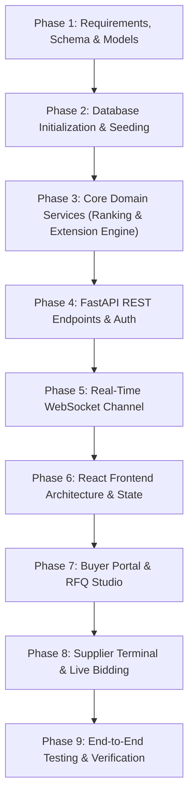

# Implementation Phases & Complete Execution Flow

---

## 1. Overview of Implementation Flow

To ensure high technical quality, rigorous validation, and end-to-end reliability, the construction of the **British Auction RFQ System** is divided into 9 systematic phases.

---

## 2. Phase-by-Phase Breakdown

### Phase 1: Database Models & Schemas
- **Objective:** Establish the 7 core entities with strict relational constraints and Pydantic validation schemas.
- **Tasks:**
  - Define `User`, `SupplierProfile`, `RFQ`, `AuctionConfiguration`, `RFQInvitation`, `Bid`, `ActivityLog` in SQLAlchemy.
  - Implement Pydantic v2 schemas for authentication, RFQ creation, quotes, bids, leaderboard entries, and activity events.
  - Enforce validation rules: $T_{start} < T_{close} < T_{forced}$, $X > 0$, $Y > 0$, non-negative charges.

### Phase 2: Database Setup & Demo Seed Data
- **Objective:** Enable one-command initialization with rich realistic freight data.
- **Tasks:**
  - Build database session factory supporting SQLite (local dev) and PostgreSQL (production).
  - Create seed script creating:
    - 1 Enterprise Buyer: Acme Logistics (`buyer@acme.com` / `password123`)
    - 4 Freight Carriers:
      - DHL Global Forwarding (`dhl@supplier.com` / `password123`)
      - Blue Dart Express (`bluedart@supplier.com` / `password123`)
      - FedEx Freight (`fedex@supplier.com` / `password123`)
      - Delhivery Logistics (`delhivery@supplier.com` / `password123`)
    - 3 Pre-configured RFQs:
      1. **Active British Auction (Delhi to Mumbai):** Near trigger window, ready for live bidding testing!
      2. **Upcoming Scheduled RFQ (Bangalore to Chennai).**
      3. **Closed RFQ with complete audit history (Mumbai to Pune).**

### Phase 3: Core Domain Services (The Auction & Bidding Engine)
- **Objective:** Implement the core business logic strictly isolated from HTTP presentation.
- **Tasks:**
  - **Ranking Service:** Retrieve latest bid per supplier, sort by total price ASC then submission timestamp ASC; assign $L1, L2, L3\dots$.
  - **Auction Extension Engine:**
    - Detect whether a bid timestamp falls inside the trigger window $[T_{close} - X, T_{close})$.
    - Evaluate trigger conditions:
      - `bid_received`: Trigger unconditionally.
      - `any_rank_change`: Detect if ranking permutation changed.
      - `l1_change`: Detect if $L1$ supplier ID changed.
    - Compute new closing time: $T_{close}' = \min(T_{close} + Y, T_{forced})$.
    - Record audit log entry in `activity_logs`.
  - **Lifecycle Manager:** Evaluates if an active auction has reached $T_{close}$ or $T_{forced}$ and transitions state to `CLOSED` or `FORCE_CLOSED`.

### Phase 4: FastAPI REST Endpoints & Authentication
- **Objective:** Expose secure, validated HTTP APIs.
- **Tasks:**
  - Auth endpoints: `/api/auth/login`, `/api/auth/register`, `/api/auth/me`.
  - RFQ endpoints: `/api/rfqs` (create, list, get details, publish, invite).
  - Bidding endpoints: `/api/rfqs/{id}/bids` (submit, get quote history, my bids).
  - Leaderboard endpoints: `/api/rfqs/{id}/leaderboard`.
  - Activity logs: `/api/rfqs/{id}/activity`.

### Phase 5: Real-Time WebSocket Infrastructure
- **Objective:** Zero-latency synchronization across connected buyers and suppliers.
- **Tasks:**
  - In-memory `ConnectionManager` routing messages by `rfq_id`.
  - Events broadcast:
    - `bid_placed`: New quote submitted.
    - `leaderboard_updated`: New ranking table.
    - `auction_extended`: New close time, extension minutes, reason.
    - `auction_closed`: Final closure notice.

### Phase 6: React Frontend Architecture & State
- **Objective:** Modern, responsive Single Page Application with clean navigation.
- **Tasks:**
  - Setup Vite + React 18 + TypeScript + Tailwind CSS + Lucide React.
  - Setup authentication context (persists token and user profile in `localStorage`).
  - Quick-switch demo account bar (1-click login as Buyer or any of the 4 Suppliers).
  - WebSocket custom hook (`useAuctionSocket`) with automatic reconnection.

### Phase 7: Buyer Portal & RFQ Studio
- **Objective:** Comprehensive UI for procurement managers.
- **Tasks:**
  - **Buyer Dashboard:** Metrics cards (Active, Scheduled, Closed, Total Suppliers) + RFQ data table with status badges and quick actions.
  - **Create RFQ Form:** 4-step structured form:
    1. Shipment & Route details.
    2. Timings ($T_{start}, T_{close}, T_{forced}$) with automatic cross-field validation.
    3. British Auction config ($X, Y$, Trigger selection A/B/C).
    4. Supplier invitations selection.
  - **Auction Details Page:** Live countdown timer, lowest bid card, active configuration summary, real-time leaderboard with charges breakdown, and chronologically sorted activity log with detailed reasons for every extension.

### Phase 8: Supplier Terminal & Live Bidding
- **Objective:** Intuitive, high-pressure competitive bidding cockpit for carriers.
- **Tasks:**
  - **Supplier Dashboard:** View invited RFQs, current personal rank ($L1, L2\dots$), and countdown.
  - **Quote Submission Form:** Initial quote entry with real-time total calculation.
  - **Live Bidding Console:**
    - Live countdown to close time and forced close time.
    - Prominent Rank Badge ($L1$ Green, $L2+$ Amber) with current lowest market bid.
    - Fast re-bid form with immediate validation (must undercut own previous bid).
    - Animated extension banner showing time added and trigger reason.

### Phase 9: End-to-End Testing & Verification
- **Objective:** Guarantee all 3 trigger types, forced close ceiling, downside bidding rules, and real-time broadcasts function reliably under test conditions.
- **Tasks:**
  - Automated Python integration test suite validating:
    - Trigger A (`bid_received` in last $X$ min $\rightarrow$ extends).
    - Trigger B (`any_rank_change` $\rightarrow$ extends only if rank moves).
    - Trigger C (`l1_change` $\rightarrow$ extends only if $L1$ changes).
    - Forced close hard ceiling clamping ($T_{close} + Y > T_{forced} \implies T_{close} = T_{forced}$).
    - Downside bid rejection (submitting higher or equal price returns `400`).
    - Non-invited supplier rejection (returns `403`).

