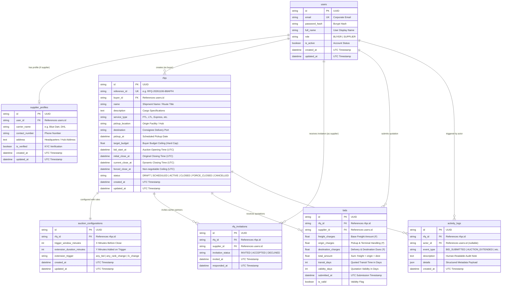

# Database Schema Design: British Auction in RFQ System

## 1. Overview & Data Model Philosophy

The database design for the British Auction in RFQ system prioritizes:
1. **Mathematical Consistency**: Calculated fields like `total_amount` ($\text{freight} + \text{origin} + \text{destination}$) and timestamps are stored with high precision.
2. **Access Control & Multi-Tenancy**: RFQ access is gated strictly by invitations, and buyers only access their own tenders.
3. **Audit Trail Completeness**: Full immutable logs of every bid, rank calculation, and time extension event.
4. **PostgreSQL & SQLite Dual Compatibility**: Compatible with both SQLite (development) and PostgreSQL (production).

---

## 2. Entity-Relationship Diagram (ERD)

---

## 3. Detailed Table Specifications

### 3.1 Table: `users`
Stores user identities, corporate credentials, and system roles.

| Column Name | Data Type | Constraints | Description |
|---|---|---|---|
| `id` | `VARCHAR(36)` | `PRIMARY KEY` | UUIDv4 identifier |
| `email` | `VARCHAR(255)` | `UNIQUE, NOT NULL, INDEX` | Corporate login email address |
| `password_hash` | `VARCHAR(255)` | `NOT NULL` | Bcrypt password hash |
| `full_name` | `VARCHAR(255)` | `NOT NULL` | User's full name |
| `role` | `VARCHAR(20)` | `NOT NULL` | Role enum: `'BUYER'`, `'SUPPLIER'` |
| `is_active` | `BOOLEAN` | `DEFAULT TRUE, NOT NULL` | Soft active status |
| `created_at` | `DATETIME` | `NOT NULL` | Account creation timestamp (UTC) |
| `updated_at` | `DATETIME` | `NOT NULL` | Last update timestamp (UTC) |

---

### 3.2 Table: `supplier_profiles`
Stores freight carrier and logistics fleet attributes associated with supplier users.

| Column Name | Data Type | Constraints | Description |
|---|---|---|---|
| `id` | `VARCHAR(36)` | `PRIMARY KEY` | UUIDv4 identifier |
| `user_id` | `VARCHAR(36)` | `FOREIGN KEY (users.id) ON DELETE CASCADE, UNIQUE, NOT NULL` | Owner user reference |
| `carrier_name` | `VARCHAR(255)` | `NOT NULL` | Commercial carrier title (e.g. Blue Dart, DHL) |
| `contact_number` | `VARCHAR(50)` | `NULLABLE` | Operations telephone contact |
| `address` | `TEXT` | `NULLABLE` | Registered logistics hub address |
| `is_verified` | `BOOLEAN` | `DEFAULT TRUE, NOT NULL` | KYC & compliance verification flag |
| `created_at` | `DATETIME` | `NOT NULL` | Record creation timestamp (UTC) |
| `updated_at` | `DATETIME` | `NOT NULL` | Record update timestamp (UTC) |

---

### 3.3 Table: `rfqs`
Central procurement order entity storing route specifications, milestones, and status.

| Column Name | Data Type | Constraints | Description |
|---|---|---|---|
| `id` | `VARCHAR(36)` | `PRIMARY KEY` | UUIDv4 identifier |
| `reference_id` | `VARCHAR(64)` | `UNIQUE, NOT NULL, INDEX` | Formatted identifier (e.g., `RFQ-20261106-B8AFF4`) |
| `buyer_id` | `VARCHAR(36)` | `FOREIGN KEY (users.id) ON DELETE CASCADE, NOT NULL` | Creator buyer ID |
| `name` | `VARCHAR(255)` | `NOT NULL` | RFQ shipment name |
| `description` | `TEXT` | `NULLABLE` | Cargo notes, weight, dimensions, packaging |
| `service_type` | `VARCHAR(100)` | `NOT NULL` | e.g. `'FTL (Full Truckload)'`, `'Air Freight'` |
| `pickup_location` | `VARCHAR(255)` | `NOT NULL` | Origin city, dock, or warehouse facility |
| `destination` | `VARCHAR(255)` | `NOT NULL` | Destination hub or delivery terminal |
| `pickup_at` | `DATETIME` | `NOT NULL` | Scheduled dispatch date |
| `target_budget` | `FLOAT` | `NULLABLE` | **Buyer Budget Ceiling**: Maximum allowable bid price |
| `bid_start_at` | `DATETIME` | `NOT NULL` | When bidding opens (UTC) |
| `initial_close_at` | `DATETIME` | `NOT NULL` | Baseline scheduled close deadline (UTC) |
| `current_close_at` | `DATETIME` | `NOT NULL` | Live dynamic closing time (extended on triggers) |
| `forced_close_at` | `DATETIME` | `NOT NULL` | Non-negotiable hard ceiling cutoff time (UTC) |
| `status` | `VARCHAR(20)` | `NOT NULL` | `'DRAFT'`, `'SCHEDULED'`, `'ACTIVE'`, `'CLOSED'`, `'FORCE_CLOSED'`, `'CANCELLED'` |
| `created_at` | `DATETIME` | `NOT NULL` | Order creation timestamp (UTC) |
| `updated_at` | `DATETIME` | `NOT NULL` | Last update timestamp (UTC) |

---

### 3.4 Table: `auction_configurations`
Stores British Auction extension parameters for an RFQ.

| Column Name | Data Type | Constraints | Description |
|---|---|---|---|
| `id` | `VARCHAR(36)` | `PRIMARY KEY` | UUIDv4 identifier |
| `rfq_id` | `VARCHAR(36)` | `FOREIGN KEY (rfqs.id) ON DELETE CASCADE, UNIQUE, NOT NULL` | Target RFQ identifier |
| `trigger_window_minutes` | `INTEGER` | `NOT NULL, DEFAULT 10` | The $X$ minute window before current close |
| `extension_duration_minutes` | `INTEGER` | `NOT NULL, DEFAULT 5` | The $Y$ extra minutes added per trigger |
| `extension_trigger` | `VARCHAR(30)` | `NOT NULL, DEFAULT 'l1_change'` | `'any_bid'` (A), `'any_rank_change'` (B), `'l1_change'` (C) |
| `created_at` | `DATETIME` | `NOT NULL` | Configuration creation timestamp (UTC) |
| `updated_at` | `DATETIME` | `NOT NULL` | Configuration update timestamp (UTC) |

---

### 3.5 Table: `rfq_invitations`
Access control table granting invited carrier partners permission to view and bid.

| Column Name | Data Type | Constraints | Description |
|---|---|---|---|
| `id` | `VARCHAR(36)` | `PRIMARY KEY` | UUIDv4 identifier |
| `rfq_id` | `VARCHAR(36)` | `FOREIGN KEY (rfqs.id) ON DELETE CASCADE, INDEX, NOT NULL` | Target RFQ |
| `supplier_id` | `VARCHAR(36)` | `FOREIGN KEY (users.id) ON DELETE CASCADE, INDEX, NOT NULL` | Invited carrier user |
| `invitation_status` | `VARCHAR(20)` | `NOT NULL, DEFAULT 'INVITED'` | `'INVITED'`, `'ACCEPTED'`, `'DECLINED'` |
| `invited_at` | `DATETIME` | `NOT NULL` | Invitation dispatch timestamp |
| `responded_at` | `DATETIME` | `NULLABLE` | Carrier response timestamp |

---

### 3.6 Table: `bids`
Stores carrier price submissions with charge breakdowns and calculated totals.

| Column Name | Data Type | Constraints | Description |
|---|---|---|---|
| `id` | `VARCHAR(36)` | `PRIMARY KEY` | UUIDv4 identifier |
| `rfq_id` | `VARCHAR(36)` | `FOREIGN KEY (rfqs.id) ON DELETE CASCADE, INDEX, NOT NULL` | Target RFQ |
| `supplier_id` | `VARCHAR(36)` | `FOREIGN KEY (users.id) ON DELETE CASCADE, INDEX, NOT NULL` | Carrier submitting the quote |
| `freight_charges` | `FLOAT` | `NOT NULL` | Linehaul freight cost (₹) |
| `origin_charges` | `FLOAT` | `NOT NULL, DEFAULT 0.0` | Origin terminal/drayage charges (₹) |
| `destination_charges` | `FLOAT` | `NOT NULL, DEFAULT 0.0` | Destination handling/delivery charges (₹) |
| `total_amount` | `FLOAT` | `NOT NULL, INDEX` | $\text{Freight} + \text{Origin} + \text{Destination}$ |
| `transit_days` | `INTEGER` | `NOT NULL, DEFAULT 3` | Promised transit duration |
| `validity_days` | `INTEGER` | `NOT NULL, DEFAULT 15` | Quote price validity duration |
| `submitted_at` | `DATETIME` | `NOT NULL, INDEX` | UTC timestamp used for tie-breaking |
| `is_valid` | `BOOLEAN` | `NOT NULL, DEFAULT TRUE` | Active/withdrawn flag |

---

### 3.7 Table: `activity_logs`
Immutable audit log tracking every milestone, rank shift, and extension event.

| Column Name | Data Type | Constraints | Description |
|---|---|---|---|
| `id` | `VARCHAR(36)` | `PRIMARY KEY` | UUIDv4 identifier |
| `rfq_id` | `VARCHAR(36)` | `FOREIGN KEY (rfqs.id) ON DELETE CASCADE, INDEX, NOT NULL` | Target RFQ |
| `actor_id` | `VARCHAR(36)` | `FOREIGN KEY (users.id) ON DELETE SET NULL, NULLABLE` | Initiating user / agent ID |
| `event_type` | `VARCHAR(40)` | `NOT NULL` | e.g. `'BID_SUBMITTED'`, `'AUCTION_EXTENDED'`, `'AUCTION_CLOSED'`, `'AUCTION_FORCE_CLOSED'` |
| `description` | `TEXT` | `NOT NULL` | Human-readable event description |
| `details` | `JSON` | `NULLABLE` | Structured payload (e.g., `{ "extended_minutes": 5, "reason": "..." }`) |
| `created_at` | `DATETIME` | `NOT NULL, INDEX` | Event timestamp (UTC) |

---

## 4. Key Performance Indexes

To ensure sub-10ms response times during high-frequency bidding:

1. **`ix_bids_rfq_total_submitted`**:
   `CREATE INDEX ix_bids_rfq_total_submitted ON bids(rfq_id, total_amount ASC, submitted_at ASC);`
   - Accelerates reverse auction leaderboard generation and instantaneous $L1$ rank determination.
2. **`ix_rfqs_buyer_status`**:
   `CREATE INDEX ix_rfqs_buyer_status ON rfqs(buyer_id, status);`
   - Speeds up Buyer Dashboard queries filtering by `ACTIVE`, `SCHEDULED`, `CLOSED`, or `CANCELLED`.
3. **`ix_rfq_invitations_supplier`**:
   `CREATE INDEX ix_rfq_invitations_supplier ON rfq_invitations(supplier_id, rfq_id);`
   - Enables fast carrier invitation verification on every bid attempt.
4. **`ix_activity_logs_rfq_created`**:
   `CREATE INDEX ix_activity_logs_rfq_created ON activity_logs(rfq_id, created_at DESC);`
   - Optimizes real-time audit log streaming and activity timeline feeds.

---

## 5. Domain Invariants & Integrity Constraints

1. **Target Budget Ceiling Invariant**:
   $$\forall \text{ bid } b \in \text{bids}, \quad \text{rfq.target\_budget} \ne \text{NULL} \implies b.\text{total\_amount} \le \text{rfq.target\_budget}$$
2. **Forced Close Clamping Invariant**:
   $$\forall \text{ extension } \Delta t, \quad \text{rfq.current\_close\_at} \le \text{rfq.forced\_close\_at}$$
3. **Strict Server-Side Total Invariant**:
   $$b.\text{total\_amount} = b.\text{freight\_charges} + b.\text{origin\_charges} + b.\text{destination\_charges}$$
4. **Tie-Break Determinism**:
   When $b_1.\text{total\_amount} = b_2.\text{total\_amount}$, rank priority is awarded to $\min(b_1.\text{submitted\_at}, b_2.\text{submitted\_at})$.
