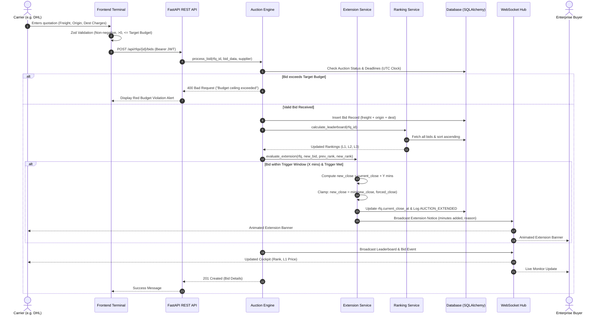

# High-Level Design (HLD): British Auction in RFQ System

## 1. System Overview

The **British Auction in RFQ (Request for Quotation) System** is a real-time reverse procurement platform tailored for enterprise logistics. Unlike traditional forward auctions where prices ascend, this reverse auction platform allows verified freight carriers to compete by bidding **downward** to capture the lowest rate ($L1$) for freight shipments.

### Key Capabilities
- **Dynamic British Auction Time Extensions**: Monitors carrier bidding activity in the final $X$ minutes (the trigger window) and automatically adds $Y$ minutes when qualified bids occur.
- **Forced Close Hard Ceiling**: Enforces an unbreachable operational cutoff time ($T_{forced}$) so shipments depart on schedule regardless of extensions.
- **Target Budget Ceiling**: Allows buyers to configure an interactive budget ceiling via a slider. Bids exceeding this budget are rejected on both client (Zod) and server.
- **Real-Time Telemetry**: Real-time broadcast of bid placements, rank updates, and animated extension notices via native WebSockets.
- **Dual Personas & 1-Click Multi-Account Switcher**: Dedicated cockpits for Enterprise Buyers and Competing Carriers (Blue Dart, DHL, FedEx, Delhivery).

---

## 2. High-Level Architecture Diagram

```mermaid
flowchart TD
    subgraph ClientLayer ["Client Layer (React 18 + TypeScript + Vite)"]
        UI_Buyer["Enterprise Buyer Studio<br/>• RFQ Creation with Budget Slider<br/>• Live Auction Monitoring<br/>• Audit Logs & Cancellation"]
        UI_Supplier["Carrier Bidding Terminal<br/>• Itemized Quote Entry<br/>• Dynamic L1-L3 Win Guidance<br/>• Real-time Countdown Timer"]
        ZOD["Zod Schema Validation Engine<br/>• Auth, RFQ Timings & Bid Constraints"]
        LENIS["Lenis Smooth Scroll & Canvas Motion"]
    end

    subgraph GatewayLayer ["API Gateway & Transport Layer (FastAPI)"]
        REST_API["REST Endpoints (/api/...)<br/>• /auth: JWT Authentication<br/>• /rfqs: CRUD & Lifecycle<br/>• /rfqs/{id}/bids: Quote Processing"]
        WS_HUB["WebSocket Connection Manager<br/>• Room-Based Broadcasting<br/>• /ws/auctions/{rfq_id}"]
    end

    subgraph EngineLayer ["Core Business Engines & Services"]
        AUTH_SVC["Authentication & RBAC Service<br/>(JWT Bearer Tokens, Roles)"]
        AUCTION_ENG["AuctionEngine<br/>• State Synchronization<br/>• Timestamp Validation (UTC)"]
        EXT_SVC["ExtensionService<br/>• Trigger Rule Evaluator (A, B, C)<br/>• Hard Ceiling Clamping"]
        RANK_SVC["RankingService<br/>• Reverse Leaderboard Sorter<br/>• Tie-Breaking by Timestamp"]
    end

    subgraph DataLayer ["Data & Storage Layer"]
        DB[(Relational DB: SQLite / PostgreSQL)]
        TABLES["Tables:<br/>users, supplier_profiles, rfqs,<br/>auction_configurations, rfq_invitations,<br/>bids, activity_logs"]
    end

    %% Flow Connections
    UI_Buyer --> ZOD
    UI_Supplier --> ZOD
    ZOD --> REST_API
    UI_Buyer <-->|WebSockets| WS_HUB
    UI_Supplier <-->|WebSockets| WS_HUB

    REST_API --> AUTH_SVC
    REST_API --> AUCTION_ENG
    AUCTION_ENG --> EXT_SVC
    AUCTION_ENG --> RANK_SVC
    
    AUCTION_ENG -->|Broadcast Event| WS_HUB
    EXT_SVC -->|Extension Alert| WS_HUB

    AUTH_SVC --> DB
    AUCTION_ENG --> DB
    RANK_SVC --> DB
    EXT_SVC --> DB
    DB --- TABLES
```

---

## 3. High-Level Sequence Diagram: Bidding & Dynamic Extension

---

## 4. Key Component Responsibilities

### 4.1 Client Layer (React 18 + Vite)
- **Logistics Canvas Motion**: Interactive 60fps HTML5 canvas simulating global freight routes and magnetic node connections on a light dusky palette.
- **Lenis Smooth Scroll**: Unified momentum smooth scroll engine across all desktop views.
- **Zod Validation Layer**: Reusable runtime schema validation for credentials, RFQ timings, and itemized quotations before sending requests to the server.
- **WebSocket Consumer (`useAuctionSocket`)**: Listens for `AUCTION_EXTENDED`, `NEW_BID`, `RANKING_CHANGED`, and `AUCTION_CLOSED` events with fallback polling.

### 4.2 Business Engine Layer (FastAPI Backend)
- **`AuctionEngine`**: Enforces system invariants:
  - Verifies carrier invitation before accepting quotations.
  - Computes total cost strictly on the server: $\text{Total} = \text{Freight} + \text{Origin} + \text{Destination}$.
  - Enforces the hard target budget ceiling: $\text{Total} \le \text{target\_budget}$.
- **`ExtensionService`**:
  - Implements all 3 British Auction trigger options:
    - **Option A (`any_bid`)**: Any valid quote submitted in the last $X$ minutes extends the auction by $Y$ minutes.
    - **Option B (`any_rank_change`)**: Any supplier rank shift ($L_i \leftrightarrow L_j$) in the last $X$ minutes triggers an extension.
    - **Option C (`l1_change`)**: Only when the market leader ($L1$) changes in the last $X$ minutes is the auction extended.
  - Clamps extensions to the forced close ceiling:
    $$T_{close}' = \min(T_{close} + Y, T_{forced})$$
- **`RankingService`**:
  - Sorts bids in ascending order of total cost.
  - Breaks ties using submission timestamps (earlier bid wins rank priority).

---

## 5. Non-Functional & Operational Qualities

| Dimension | Implementation |
|---|---|
| **Authoritative Time Source** | All deadlines and comparisons evaluate strictly against the server's UTC clock (`datetime.utcnow()`). Client countdowns are presentation-only. |
| **High Concurrency & Safety** | Thread-safe in-memory room tracking and database transactions guarantee consistent extension evaluations under simultaneous carrier bids. |
| **Idempotency & Resilience** | Real-time WebSocket connection automatically recovers via reconnect loops and fallback polling (`8000ms`). |
| **Clean Architectural Decoupling** | Modular split across REST routers, domain models, Pydantic/Zod schemas, and socket managers. |
