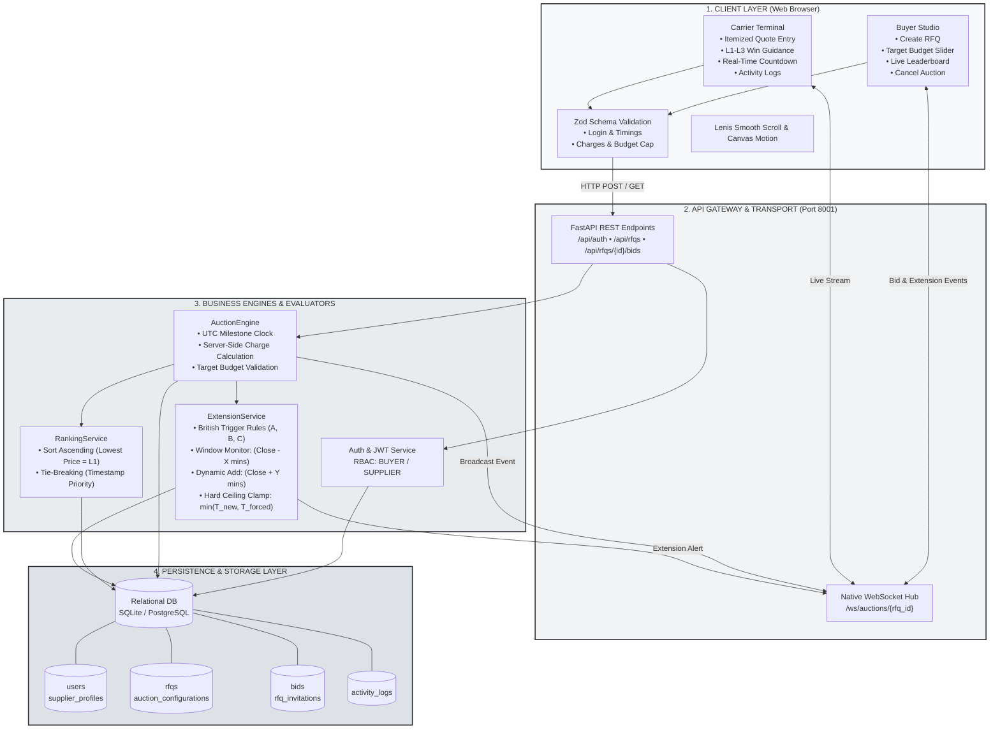
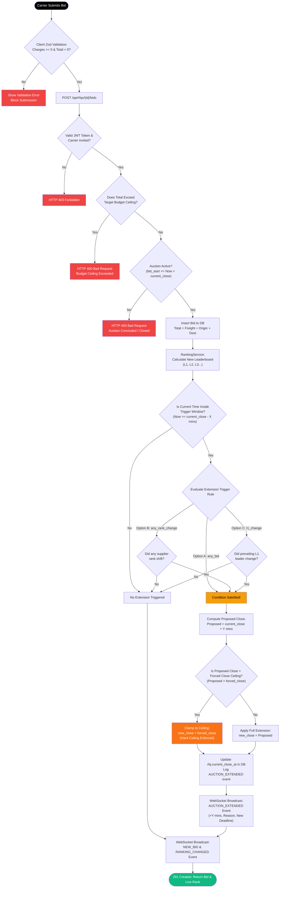
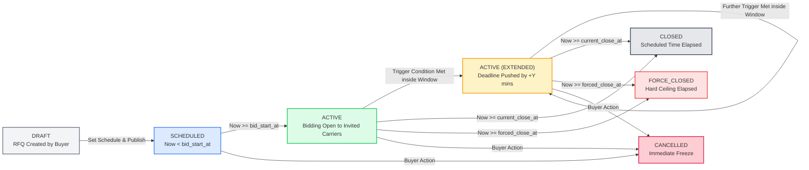
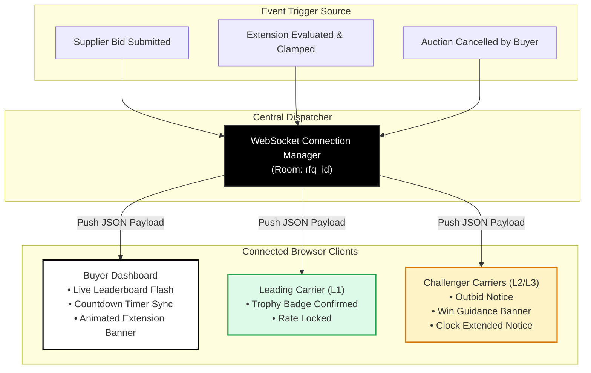

# High-Level Design (HLD): British Auction in RFQ System

---

## 1. System Architecture Diagram



---

## 2. Visual Architecture Box Diagram (Overview)

```text
+---------------------------------------------------------------------------------------------------+
|                                       1. CLIENT PRESENTATION LAYER                                |
|                                                                                                   |
|   +---------------------------------------------+   +-----------------------------------------+   |
|   |         ENTERPRISE BUYER STUDIO             |   |         CARRIER BIDDING TERMINAL        |   |
|   |  - RFQ Creation with Budget Slider (Zod)    |   |  - Itemized Quote Entry (Freight+Origin)|   |
|   |  - Live Reverse Auction Leaderboard         |   |  - Dynamic L1-L3 Win-Probability Guide  |   |
|   |  - Cancel Auction & Audit Log Viewer        |   |  - Dual Timers (Close vs Forced Cap)    |   |
|   +---------------------------------------------+   +-----------------------------------------+   |
|                                         |                                 |                       |
|                                         v                                 v                       |
|   +-------------------------------------------------------------------------------------------+   |
|   |                  ZOD VALIDATION ENGINE  &  LENIS SMOOTH SCROLL / CANVAS MOTION            |   |
|   +-------------------------------------------------------------------------------------------+   |
+-----------------------------------------------|---------------------------------------------------+
                                                | HTTP Requests & WebSockets
                                                v
+---------------------------------------------------------------------------------------------------+
|                                   2. API GATEWAY & ROUTER LAYER                                   |
|                                                                                                   |
|   +---------------------------------------------+   +-----------------------------------------+   |
|   |         FASTAPI REST CONTROLLERS            |   |        WEBSOCKET CONNECTION MANAGER     |   |
|   |  - POST /api/auth/login                     |   |  - /ws/auctions/{rfq_id} (Room Based)   |   |
|   |  - GET/POST /api/rfqs                       |   |  - Real-time Bid & Extension Broadcast  |   |
|   |  - POST /api/rfqs/{id}/bids                 |   |  - Active Reconnect & Fallback Polling  |   |
|   +---------------------------------------------+   +-----------------------------------------+   |
+-----------------------------------------------|---------------------------------------------------+
                                                |
                                                v
+---------------------------------------------------------------------------------------------------+
|                                 3. BUSINESS & AUCTION ENGINES                                     |
|                                                                                                   |
|   +-------------------------+  +--------------------------+  +--------------------------------+   |
|   |      AUCTION ENGINE     |  |     RANKING SERVICE      |  |       EXTENSION SERVICE        |   |
|   | - UTC Clock Authority   |  | - Reverse Sorting (Min ₹)|  | - Trigger Window Check (X min) |   |
|   | - Total Amount Compute  |  | - Tie-Breaking via Time  |  | - Dynamic Add (Y min)          |   |
|   | - Budget Ceiling Check  |  | - Rank Assign (L1,L2,L3) |  | - Forced Ceiling Clamp Rule    |   |
|   +-------------------------+  +--------------------------+  +--------------------------------+   |
+-----------------------------------------------|---------------------------------------------------+
                                                | SQL / ORM Queries
                                                v
+---------------------------------------------------------------------------------------------------+
|                                     4. DATABASE STORAGE LAYER                                     |
|                                                                                                   |
|   [users] -----------> [supplier_profiles]           [rfqs] <----------> [auction_configurations] |
|      |                                                 |                                          |
|      +---------------------+---------------------------+                                          |
|                            |                           |                                          |
|                            v                           v                                          |
|                     [rfq_invitations]                [bids] -------------> [activity_logs]        |
+---------------------------------------------------------------------------------------------------+
```

---

## 3. End-to-End Bidding & Extension Decision Flowchart



---

## 4. Auction Lifecycle State Machine Flowchart



---

## 5. Real-Time Telemetry & WebSocket Event Distribution



---

## 6. Mathematical Formulas & Invariants

```text
+---------------------------------------------------------------------------------------------------+
| 1. QUOTATION TOTAL CALCULATION                                                                    |
|    Total = Freight_Charges + Origin_Charges + Destination_Charges                                 |
+---------------------------------------------------------------------------------------------------+
| 2. TARGET BUDGET CEILING INVARIANT                                                                |
|    Total <= Target_Budget  (Bids > Target_Budget are rejected with HTTP 400)                      |
+---------------------------------------------------------------------------------------------------+
| 3. TRIGGER WINDOW INCLUSION FORMULA                                                               |
|    Inside_Window = (Current_Time >= Current_Close_Time - X minutes) AND (Current_Time < Close)    |
+---------------------------------------------------------------------------------------------------+
| 4. EXTENSION ADDITION & HARD CEILING CLAMPING FORMULA                                             |
|    T_proposed = Current_Close_Time + Y minutes                                                    |
|    New_Close_Time = min(T_proposed, Forced_Close_Time)                                            |
+---------------------------------------------------------------------------------------------------+
| 5. REVERSE LEADERBOARD RANKING DETERMINATION                                                      |
|    Rank = Order_By(Total_Amount ASC, Submitted_At ASC)                                            |
|    (Lowest price captures L1; ties broken by earliest submission timestamp)                       |
+---------------------------------------------------------------------------------------------------+
```
